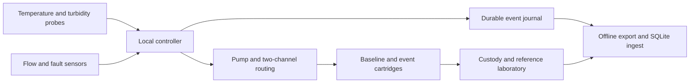

# Technical and data architecture

Proposed hardware comprises an ESP32-class controller, replaceable inlet and tubing, peristaltic pump, normally closed routing, measured flow, shared protected low-voltage power, and separated wet and dry compartments. Use an external supervised power supply first. Select connectors and wetted materials after compatibility tests. A cartridge contract will specify mechanical fit, routing, consumable lot, medium, allowable pressure and flow, and sample handoff. Cold design must account separately for ambient air, water, fluid-path freezing, and battery derating.

Proposed firmware boundaries are sensor drivers, mission policy, actuator interlocks, and a durable journal. The local policy reserves a cartridge, records intent, then actuates. It applies threshold persistence and hysteresis, and stops on timeout, no flow, leak or low power. On reboot with ambiguous physical state, stop and quarantine the slot for inspection. Connectivity is optional. Export timestamped records with stable IDs and a manifest. Future ingest should stage, validate and commit atomically, treating an exact re-upload as a no-op and conflicting IDs as a review item.

## Data dictionary

| Table | Grain and relationship |
|---|---|
| missions | Deployment or experiment with device ID, time window and synthetic flag |
| provenance | Versioned artifact or configuration per mission, with SHA-256 of source bytes |
| calibrations | Sensor, validity window, method and reference per mission |
| observations | Timestamped raw and calibrated values with unit and calibration link |
| events | Trigger or operational decision, optionally linked to the driving observation |
| cartridges | Installed physical cartridge per mission slot with serial and lot |
| samples | One collection attempt per cartridge in Phase I, linked to event and volume |
| qc | Append-oriented sample-level QC record with rule version, verdict and reason |
| custody | Timestamped transfers with holder identifiers and condition |

Composite keys prevent links across missions. Time strings are UTC ISO 8601 by convention. Calibrated observations require a matching sensor calibration ID. A future production ingest must additionally validate event ordering, calibration window, UTC format, manifest integrity and custody continuity. Preserve raw values and version reprocessing outputs. Export the synthetic flag with every flattened record. Restrict actual sites and custodian identities via an access-controlled registry.

## Repository structure

This release implements `db/` and `examples/`. Planned build directories are `firmware/` for embedded control, `hardware/` for CAD, wiring and cartridge interfaces, and `validation/` for fixtures and result reports. Those components are Phase I deliverables.
